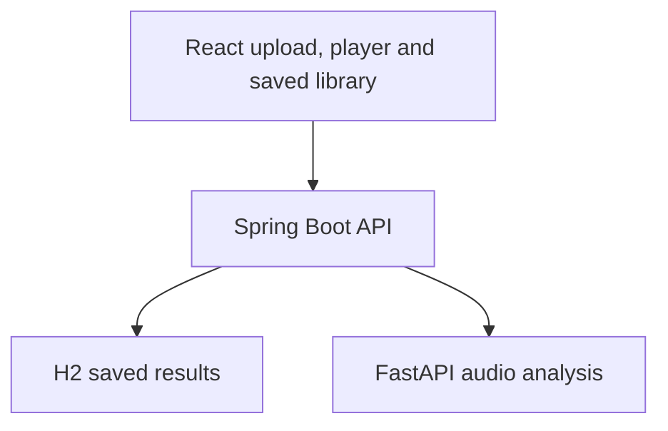

# Music Description Studio

A local music analysis app built with React, Spring Boot, and Python. Upload an MP3 or WAV to play it through a seekable full-song waveform, estimate tempo and audio features, and automatically rank experimental music feelings. Save listening notes, BPM corrections, favorites, and analysis summaries between sessions.

## What it does

- Shows a clickable, draggable full-song waveform instead of a browser audio progress slider. Arrow keys seek five seconds when the waveform has focus.
- Estimates BPM, energy, brightness, and zero-crossing rate. Tap tempo and half/double-time comparisons help interpret uncertain BPM estimates.
- Automatically uses a pretrained CLAP model after an upload to rank ten music descriptions from a short excerpt. The first run downloads model weights and can take a while. If analysis fails, the feeling panel offers a retry.
- Samples eight sections across the song when you select **Analyze Full-Song Timeline**.
- Saves analysis summaries, listening notes, favorites, and corrected BPM in a local H2 database. Uploaded audio is deleted from temporary storage after processing.
- Searches saved results by filename, description, or notes, and filters by BPM, top description, or favorites.

These feeling scores are relative audio-text matches, **not calibrated probabilities** and not a measure of a listener's emotions. The automatic BPM may reflect a half-time or double-time feel. Uploaded files must be MP3 or WAV, at most 100 MB and 10 minutes.

## Architecture



Spring validates and forwards uploaded files to Python over local HTTP/1.1. Python decodes temporary PCM WAV files with FFmpeg and extracts audio features with librosa; CLAP ranks music descriptions. The server stores analysis summaries, not uploaded audio or full waveforms. The sampled timeline is returned to the browser without being stored.

## Update your existing Mac project

If your current project is in `~/Downloads/music-description-studio-8`, extract this complete ZIP in Downloads and run from its extracted folder:

```bash
cd ~/Downloads/music-description-studio-local-analysis
bash update-current-mac.sh
```

The updater replaces the changed frontend and Java settings, deletes obsolete integration source files and Maven build output, then rebuilds and restarts this project's services. It **preserves** your `backend/.venv`, `frontend/node_modules`, and `server/music-library.mv.db` saved results. If your existing project is in a different folder, pass that folder's full path as an argument:

```bash
bash update-current-mac.sh /path/to/your/existing-project
```

The previous `server/.env`, if present, is left untouched but is **no longer loaded** by the startup script. You can remove it yourself if it contains only settings you no longer use. Extracting a newer ZIP over an older folder without running the updater will leave old Java source files in place and may break the Spring build.

## Requirements

- macOS with Java 17 or newer and Maven 3.6.3 or newer
- Python 3.12 or 3.13
- Node.js and npm
- Disk space for Python packages and the CLAP weights downloaded on first analysis

## Run locally

After installing dependencies, run from the project root:

```bash
bash start-mac.sh
```

Open <http://127.0.0.1:5173>. The script starts and checks Python on port 8000, Spring Boot on 8080, and React/Vite on 5173. Logs are written to `run-logs/`. To stop them, run `bash stop-mac.sh` from this project. The scripts leave services from other project folders alone.

### First-time setup

Install Python and frontend dependencies once from the project root:

```bash
cd backend
python3 -m venv .venv
.venv/bin/python -m pip install -r requirements.txt
cd ../frontend
npm ci
cd ..
bash start-mac.sh
```

You can also run the components separately in three terminals: `backend/.venv/bin/python -m uvicorn main:app --host 127.0.0.1 --port 8000` from `backend`; `mvn spring-boot:run` from `server`; `npm run dev` from `frontend`. Keep each terminal open. If a service fails, read its log under `run-logs/`. `start-mac.sh` installs the bundled audio decoder in the project's Python environment if it is missing.

The H2 database file is `server/music-library.mv.db`. Keep it when updating if you want your saved results. For nondefault local addresses, set `ANALYZER_URL` before starting Spring or `VITE_API_BASE` before starting Vite.

## Main API routes

| Route | Purpose |
| --- | --- |
| `POST /api/tracks/analyze` | Upload audio, return waveform and features, save summary |
| `GET /api/tracks` | List saved summaries |
| `PATCH /api/tracks/{id}` | Save notes, BPM correction, or favorite |
| `POST /api/tracks/{id}/description` | Rank descriptions with CLAP and save the top match |
| `POST /api/tracks/{id}/timeline` | Return an eight-section sampled timeline |
| `DELETE /api/tracks/{id}` | Delete a saved summary |

The multipart upload field is `audio`. Spring forwards the validated file to Python as raw audio bytes with the extension in a header. Java uses HTTP/1.1 explicitly because a default h2c upgrade caused Uvicorn to reject uploads in this local setup.

## Verification and limits

A full local MP3 upload was verified on macOS: playback, waveform seeking, features, CLAP feeling match, sampled timeline, and saved library result. The model describes a sampled excerpt; its labels may not reflect the whole song. The timeline samples eight excerpts rather than continuously classifying every moment. This app runs locally and does not provide hosted accounts. To run the saved-library filter checks, use `npm test` in `frontend`.
