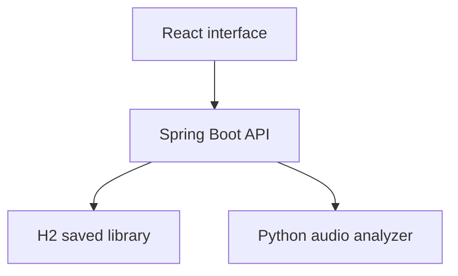

# Music Description Studio

A local full-stack music analysis app built with React, Spring Boot, and Python. Upload an MP3 or WAV to see its waveform, estimated BPM, audio features, and experimental music descriptions. Save listening notes, tempo corrections, and favorites between sessions.

This is an **educational, local-first project**. It does not integrate with Spotify or Apple Music, store uploaded audio, or authenticate multiple users.

## What it does

- Plays MP3/WAV uploads and draws a full-song peak waveform.
- Estimates tempo, energy, brightness, and zero-crossing rate from audio. Tap tempo and half/double-time comparisons help interpret uncertain BPM estimates.
- Uses a pretrained CLAP model to rank ten music descriptions and sample eight sections across a song. These are relative matches, not calibrated probabilities.
- Saves analysis summaries, notes, favorites, and corrected BPM in a local H2 database. Uploaded songs are deleted from temporary storage after processing.

## Architecture



- **React** owns the player, waveform, tap tempo, and saved-library interface.
- **Spring Boot** validates incoming uploads, exposes the public REST API, streams the audio bytes to the analyzer, and persists analysis summaries and user corrections with JPA.
- The local Java-to-Python upload uses HTTP/1.1 explicitly. Java's default h2c upgrade caused Uvicorn to reject the upload with `Invalid HTTP request received` before Python could inspect the audio.
- **Python** owns music feature extraction and model inference. It converts uploads to temporary PCM WAV using a bundled FFmpeg binary. Java writes each upload to a temporary file while forwarding it; both services delete their temporary files after the response. The database stores no audio. The sampled timeline is returned to the browser but is not persisted.

The split is intentional: Java demonstrates REST and persistence, while Python keeps the existing librosa and CLAP code instead of rewriting audio analysis in a language that lacks those dependencies.

## Requirements

- Java 17 or newer and Maven 3.6.3 or newer
- Python 3.12 or 3.13
- Node.js and npm
- Enough disk space for the Python dependencies (including bundled FFmpeg) and the CLAP model downloaded on first description request

## Run locally

### Mac: one command after setup

If you have already installed the Python and frontend dependencies, run this
from the project root:

```bash
bash start-mac.sh
```

This restarts this project's existing services, waits for ports 8000, 8080,
and 5173, and prints the recent error logs if a service fails. It leaves other
projects' processes alone. It installs the bundled audio decoder if it is
missing from this project's Python environment. The three logs are in
`run-logs/`. Run `bash stop-mac.sh` when finished.
Keep the existing `server/music-library.mv.db` if you have saved tracks.

### First-time setup or manual run

Open three terminals, from this project's root directory:

**1. Python analyzer**

```bash
cd backend
python3 -m venv .venv  # use Python 3.12 or 3.13
source .venv/bin/activate
python -m pip install -r requirements.txt
python -m uvicorn main:app --host 127.0.0.1 --port 8000
```

**2. Java API**

```bash
cd server
mvn spring-boot:run
```

**3. React client**

```bash
cd frontend
npm ci
npm run dev
```

Open <http://127.0.0.1:5173>. The Java service listens on 127.0.0.1:8080. Set `ANALYZER_URL` before starting Java if Python uses a different address. Set `VITE_API_BASE` for the frontend if Java uses a different address.

For later manual runs, you do not need to reinstall dependencies. In three separate terminals,
run `source .venv/bin/activate && python -m uvicorn main:app --host 127.0.0.1 --port 8000`
from `backend`, `mvn spring-boot:run` from `server`, and `npm run dev` from
`frontend`. Keep all three terminals open. Closing one stops its service.
If port 8000 is already in use, Python is likely still running in another terminal;
check <http://127.0.0.1:8000/api/health> before starting another copy.

The H2 database is created at `server/music-library.mv.db` and survives server restarts. It stores filenames, numeric features, the top description label, notes, favorites, and BPM corrections. It does **not** store the song or its full waveform.

## Main API routes

| Route | Purpose |
| --- | --- |
| `POST /api/tracks/analyze` | Upload MP3/WAV; return waveform/features; save summary |
| `GET /api/tracks` | List saved summaries, newest first |
| `PATCH /api/tracks/{id}` | Save notes, BPM correction, or favorite |
| `POST /api/tracks/{id}/description` | Forward audio to CLAP; save top label |
| `POST /api/tracks/{id}/timeline` | Return sampled description timeline |
| `DELETE /api/tracks/{id}` | Remove saved summary |

The upload field is named `audio`. MP3 and WAV are accepted up to 100 MB and 10 minutes. The CLAP scores are relative text-audio similarities, **not** calibrated probabilities. Beat tracking has half/double-time ambiguity; tap tempo and a saved correction let the listener make the final call.

If the upload fails, the response includes the Python analyzer's error details. The browser sends multipart data to Spring; Spring forwards the validated file as raw audio bytes to Python so the second hop does not depend on another multipart parser.

## Walkthrough you can use in an interview

1. In `frontend/src/main.jsx`, selecting a file calls the Spring `/api/tracks/analyze` endpoint. The response draws the waveform and metrics.
2. `TrackController` maps that request to `TrackService`. The service checks the file and calls `AnalyzerClient`.
3. `AnalyzerClient` streams the validated audio to Python `/api/analyze-raw`, with the file extension in an HTTP header.
4. Python calculates the features and waveform. Java saves only the summary through `TrackRepository`, which is a Spring Data JPA repository backed by H2.
5. The library screen uses `GET /api/tracks` and `PATCH /api/tracks/{id}` to show history and save your notes, favorite, or corrected BPM.

## Verification and current limits

The full local flow was verified on macOS with an MP3: upload, BPM and audio features, waveform, CLAP description, sampled timeline, and a saved library result. Request-level checks also sent an MP3 and a 41 MB WAV from Java's HTTP client to Uvicorn successfully; an invalid audio upload returned a clear 400 error.

The app is local-only. Spotify/Apple Music integration and spectrogram views shown as planned in the UI are not implemented. The description model is experimental, and automated BPM can be ambiguous; human listening and a saved correction are supported. Notes surviving a Java restart have not yet been independently checked.

